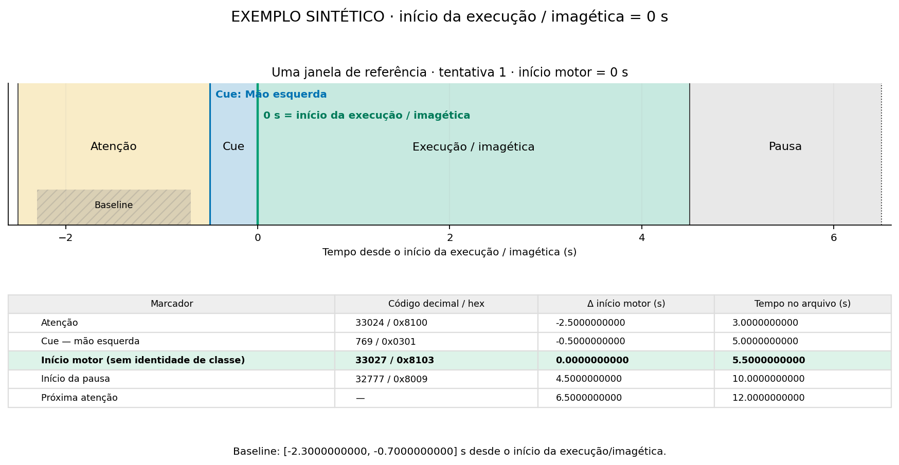

# Análise de execução motora, imagética e pseudo-coadaptação

Projeto local em Python, com EDA por sujeito e avaliação dos classificadores. Os
CSV originais não são alterados. As configurações ficam em **`config.yaml`**.
Não é necessário GPU, banco de dados ou servidor web.

**Estado desta entrega:** fluxo validado com sinais sintéticos, inclusive geração
dos relatórios. Os quatro anexos reais excederam o limite de transferência de
32 MiB por arquivo da ferramenta; seu conteúdo integral ainda não foi processado
aqui. O cabeçalho fornecido informa 512 Hz, 16 canais EEG, dois auxiliares e
marcações OpenViBE. As posições da touca e a unidade física continuam pendentes.
Os exemplos gerados por `demo` são explicitamente sintéticos.

## 1. Instalar e inspecionar

Use Python **3.11 ou 3.12**, preferencialmente 3.12, em um ambiente virtual:

```bash
python -m venv .venv
source .venv/bin/activate
python -m pip install -r requirements.txt
python run_analysis.py inspect --data /caminho/para/dados
```

No PowerShell, substitua a ativação por `.venv\Scripts\Activate.ps1`.

O comando `inspect` não exige conhecer unidade ou atenção. Ele lê cada arquivo,
confere timestamps, taxa e canais, e produz:

- `results/inventory.csv`: nomes, sujeito, sessão, bloco, duração, contagem dos
  códigos e erros de leitura. Pode servir como manifest editável para grupos.
- `results/markers.csv`: **todas** as marcações, com instante original, duração,
  código e nome padrão quando conhecido. Ajuda a conferir a sequência real.

`Epoch` no CSV OpenViBE é índice do buffer de aquisição, **não** a identidade da
tentativa. As tentativas são reconstruídas pelos eventos de atenção e cue.
`Event Date` tem prioridade sobre o timestamp da linha: por exemplo, um evento
em `0.0234241611` s não deve ser deslocado para o instante da amostra que o contém.
Eventos múltiplos separados por `:` e linhas contendo apenas eventos são aceitos.
Descontinuidades e amostras parcialmente faltantes geram erro; não são interpoladas.

## 2. Organização dos arquivos e grupos

A descoberta é recursiva. A convenção confirmada é:

```text
dados/
  grupo_opcional/
    EG102/
      motor_me_EG102_1.csv
      motor_mi_EG102_1.csv
      motor_mi_EG102_online_1a.csv
      motor_mi_EG102_online_1b.csv
      motor_mi_EG102_online_1c.csv
      motor_mi_EG102_online_1d.csv
      ... mesmas seis categorias nas sessões 2 a 6 ...
```

`me` significa execução; `mi` no nome é convertido para `im` nas tabelas.
`EG102_2` significa **sessão 2**, não o segundo bloco. Sujeito pode mudar.
São esperados 36 arquivos por sujeito; faltas aparecem no inventário do relatório.
O código não confunde `online_1a` com sessão/bloco offline.

Para definir grupos, edite `group` no `inventory.csv` e use-o como manifest:

```bash
python run_analysis.py run --data /caminho/para/dados --manifest results/inventory.csv
```

O manifest requer `path,subject,session,block`; `group` é opcional e fica
`unspecified` quando ausente. `path` é relativo à raiz `--data`, ou absoluto.
Um sujeito só pode pertencer a um grupo. A pasta do grupo **não** é interpretada
automaticamente como diagnóstico/condição. Arquivos fora da convenção exigem
manifest ou `input.filename_regex` com grupos `subject`, `session`, `block`.

## 3. Conferir os poucos parâmetros que dependem da aquisição

Edite `config.yaml` antes de `run`:

1. **`events.attention`**: preencher com o código real identificado no cenário
   OpenViBE ou na sequência de `markers.csv`. Sem ele a análise para, pois não
   existe baseline confiável. Não basta haver um código chamado `BaselineStart`:
   é preciso confirmar que corresponde à atenção deste protocolo.
2. **`events.left` / `right`**: por padrão, GDF_Left `769` / GDF_Right `770`.
   A classe da tentativa vem **exclusivamente da cue**. O marcador motor não dá a
   identidade. Label_01/Label_02, se usados no cenário, precisam ser mapeados
   explicitamente; a associação esquerda/direita não é adivinhada.
3. **`events.task_start` / `rest_start` / `trial_stop`**: preencher/conferir
   conforme o cenário. `task_start` vazio não inventa início motor. O anchor
   padrão é a cue; use `epochs.anchor: task_start` se houver esse marcador.
4. **`input.eeg_unit`**: começa como `native`, porque o cabeçalho fornecido não
   confirma a escala exportada pelo V-Amp/OpenViBE. Nesse modo, amplitudes/PSD
   estão em **u.a.**, e limiares físicos em µV ficam desativados; apenas canais
   exatamente constantes são detectados como planos. Após confirmar o ganho da
   aquisição/exportação, definir `uV`, `mV` ou `V`. Não inferir pela amplitude/DC.
   O ERD relativo não depende de um fator global de escala comum, mas unidades e
   ganhos continuam necessários para interpretar potência absoluta entre sujeitos.
5. **`input.channel_names`**: substituir a lista artificial pela sequência real
   dos 16 eletrodos. Depois disso, definir `figures.montage_confirmed: true`.
   A lista provisória NÃO é a montagem do EG102. Os mapas e os rótulos C3/C4 ficam
   marcados como ilustrativos enquanto não confirmados. `Aux 1/2` ficam excluídos.

Alguns códigos padrão que ajudam a ler o inventário:

| Código | Significado padrão |
|---|---|
| 32769 / 0x8001 | ExperimentStart — não é atenção |
| 32773 / 0x8005 | TrialStart |
| 32775 / 0x8007 | BaselineStart |
| 769 / 0x0301 | GDF_Left |
| 770 / 0x0302 | GDF_Right |
| 32777 / 0x8009 | RestStart |
| 800 / 0x0320 | GDF_End_Of_Trial |

São nomes padrão, não prova de como o cenário experimental foi programado.
`input.event_time: absolute` é o padrão para Event Date do CSV OpenViBE;
`row` e `relative_to_row` existem apenas para exportações com essas convenções.

## 4. Executar

```bash
python run_analysis.py run --data /caminho/para/dados --subject EG102
# Só EDA, sem treinar modelos:
python run_analysis.py run --data /caminho/para/dados --subject EG102 --eda-only
```

Sem `--subject`, processa todos os sujeitos encontrados, um de cada vez.
Caminhos no YAML são relativos ao próprio YAML; caminhos da linha de comando
são relativos ao diretório de execução. Parâmetros de linha de comando têm prioridade.

Cada sujeito recebe somente cinco arquivos em `results/EG102/`:

| Arquivo | Conteúdo |
|---|---|
| `report.html` | EDA comentado e figuras incorporadas; abrir no navegador local |
| `figures.pdf` | Figuras multipágina, texto/linhas vetoriais; mapas TFR rasterizados |
| `tables.zip` | Sete CSVs: inventory, events, trials, channel_qc, bandpower, scores, predictions |
| `config-used.yaml` | Parâmetros efetivamente usados |
| `run-info.json` | Versões e identificação da execução |

Hashes SHA-256 dos arquivos analisados estão no inventário. Uma falha não publica
um relatório parcial como se estivesse concluído. Para repetir, use `--overwrite`,
que substitui esses arquivos gerados e preserva outros arquivos da pasta.

Por padrão há figuras detalhadas do primeiro `me`, primeiro `im` e primeiro
online disponível, evitando centenas de páginas repetidas. **As medidas e os
classificadores usam todos os blocos disponíveis.** Para figuras de todos os
blocos, definir `figures.selection: all`.

## 5. O que o EDA calcula

O caminho de leitura do código é `eeg_io.py` → `eeg_processing.py` →
`eeg_figures.py`; `run_analysis.py` apenas organiza a execução.

- EEG bruto e depois do bandpass de 1–40 Hz, notch opcional e referência média
  opcional. Mesmos canais, janela e escala; o bruto é centrado apenas para exibição.
  O eixo usa o início da execução/imagética da tentativa de referência como zero.
  Sem esse marcador, mostra o tempo absoluto no arquivo com aviso explícito.
- Uma **janela de referência dos marcadores**, com fundos coloridos para
  atenção/cue/tarefa/pausa e linhas verticais nas marcações, sem bolinhas. Uma
  tabela dentro da imagem mostra tempos com dez casas decimais, tanto absolutos
  quanto relativos ao **início da execução/imagética (t = 0)**. Atenção, baseline
  e cue anteriores ficam em tempos negativos. A classe é escrita na cue. Quando
  não há início motor marcado, a referência não é desenhada; a figura solicita
  configurar `events.task_start`, sem usar atenção ou cue como substituto do zero.
  Essa origem visual não modifica os anchors das janelas de análise nem a baseline
  de atenção. `events.csv` preserva tempos relativos à atenção, à cue e ao início motor.
- PSD por classe e canal de interesse, comparando atenção e atividade; espectrogramas
  absolutos e relativos à baseline; curvas ERD/ERS de mu (8–13 Hz) e beta (13–30 Hz).
- Topografia da potência e do ERD no **escalpo**. Isso não é uma reconstrução de
  fontes corticais; posições artificiais não sustentam conclusões anatômicas.

Referência visual com **dados sintéticos**, também disponível em `marker_reference.png`:



A baseline de **cada tentativa** é:

```text
[atenção + 0,2 s, cue − 0,2 s]
```

O mínimo padrão é 1 s; ajuste as margens/janelas se o protocolo tiver atenção
mais curta. Não encurtar automaticamente baselines ruins. Atividade: 0,5–4,5 s
após o anchor; classificação: **0,5–2,5 s**, uma janela única de **2 s**. As janelas
não podem invadir a pausa ou a próxima tentativa. Se forem curtas/inválidas, o
motivo fica em `trials.csv`. A rejeição por artefato vale para baseline, atividade
e janela de classificação. Não há ICA, correção de EOG ou detecção automática de
canais ruins; liste `bad_channels` antes de refazer a referência.

Os filtros são IIR **causais e contínuos**, sem usar amostras futuras; introduzem
atraso de fase e têm transitório inicial descartado. Seus parâmetros são fixos,
não ajustados usando o teste. A classificação recebe um bandpass adicional
8–30 Hz. Baseline é referência espectral; não se subtrai potência em µV do sinal.

Para cada tentativa, canal e banda:

```text
ERD/ERS (%) = 100 × (potência na atividade / potência na atenção − 1)
```

Negativo indica ERD; positivo, ERS. Integramos os bins `[inferior, superior)` antes
da razão de banda; não contamos 13 Hz nas duas bandas. O bootstrap reamostra
**tentativas**, não canais, com semente fixa. Seus intervalos são descritivos
dentro do sujeito, sem tratar tentativas como sujeitos independentes. TFR usa
janelas de 1 s com passo próximo de 0,1 s; a resolução verdadeira de frequência
é aproximadamente 1 Hz. Um bin temporal representa uma janela, não um instante
sem suavização. Em TFR, a baseline usa janelas totalmente contidas na atenção.

## 6. Classificação e cronologia

Implementação em `eeg_classification.py`, usando scikit-learn e pyRiemann:

| Representação | Classificadores |
|---|---|
| Ledoit–Wolf → TGSP (espaço tangente riemanniano) → StandardScaler | LDA, SVM linear, SVM RBF |
| Ledoit–Wolf → CSP com log-potência → StandardScaler | LDA, SVM linear, SVM RBF |

LDA usa shrinkage; SVM usa `C=1`, `gamma=scale`, pesos balanceados. Há até quatro
componentes CSP. Cada fold aprende sua própria representação e escala. Não há
busca de hiperparâmetros nem escolha do melhor modelo a partir do teste online.
Uma futura busca deve usar CV **aninhada** apenas no treino.

1. **`offline_cv`**: CV separada para cada `me`/`im`, até cinco folds estratificados,
   reduzidos ao número disponível de tentativas da classe minoritária. Uma
   tentativa não aparece em dois lados de um fold. Os resultados `fold=all` são
   predições fora do fold (OOF), sem duplicar as tentativas ao combinar folds.
   A CV estratificada não mede extrapolação temporal e pode ser otimista sob
   deriva; `cv_scheme: forward` ativa TimeSeriesSplit e registra sua cobertura.
2. **`session_im_frozen`**: TGSP+SVM treinado no `im` da mesma sessão, avaliado
   separadamente em a, b, c, d sem atualização. É comparador diagnóstico;
   usar `im2` aqui NÃO altera o protocolo adaptativo abaixo.
3. **`adaptive_protocol`**: inicializa **somente com IM da sessão 1**. Prediz 1a,
   depois incorpora seus rótulos verdadeiros; prediz 1b, incorpora 1b; segue até
   1d, 2a, …, 6d. Cada passo refaz o pipeline cumulativamente com todos os blocos
   passados. **IM2–IM6 nunca entram no treino desse experimento.**

A SVM online padrão é RBF, configurável para linear. O teste ocorre antes da
atualização; não há auto-rotulação nem teste usando treino do próprio bloco.
Acurácia, acurácia balanceada, kappa, IC de Wilson da acurácia e predições por
tentativa são exportados. Os ICs binomiais são descritivos e não corrigem
dependência temporal. O campo `train_blocks` permite auditar cada treino.

Ausência de IM1 impede reproduzir o protocolo. Uma lacuna na sequência online
interrompe suas avaliações seguintes, preservando avaliações anteriores. Só
`allow_protocol_gaps: true` autoriza usar a sequência parcial observada, que é
identificada como tal no relatório. Resultados `skipped` não são acurácia zero.
Os quatro arquivos de referência incluem IM2, IM4, online1a/1b; sozinhos **não
permitem inicializar o protocolo** nem o modelo congelado da sessão 1. Para isso
é necessário pelo menos `motor_mi_EG102_1.csv`.

Esta é uma simulação supervisionada offline da atualização de modelos, compatível
com uma pseudo-coadaptação. Não reconstitui decisões/feedback do modelo original
nem demonstra adaptação do participante. Sem marcadores do feedback ou rótulos
de intenção verificados, não inferir esses efeitos a partir da acurácia.

## 7. Futuras comparações de grupos

Todas as tabelas preservam `subject,group,session,block`; potência e predições
preservam `trial_id`. `bandpower.csv` tem uma linha por tentativa × canal × banda,
com potência basal, ativa, ERD e unidade. `channel_qc.csv` preserva também a
coluna original e o estado de confirmação das posições.

Isso permite agregar primeiro por sujeito/sessão e depois comparar grupos, ou
usar modelos hierárquicos com sujeito como unidade. Não há pooling de tentativas
entre sujeitos, teste de hipótese entre grupos ou seleção de eletrodos baseada
no resultado nesta etapa. Antes disso: montagem real, unidades/ganhos,
comparabilidade de aquisição, perdas/artefatos por grupo e controle de múltiplas
comparações precisam estar definidos.

Para ler uma tabela sem extrair vários arquivos:

```python
from zipfile import ZipFile
import pandas as pd
with ZipFile("results/EG102/tables.zip") as z:
    power = pd.read_csv(z.open("bandpower.csv"))
```

## 8. Testar sem os dados reais

```bash
python -m pytest -q
python run_analysis.py demo --output demo
python run_analysis.py inspect --config demo/config.yaml
python run_analysis.py run --config demo/config.yaml
```

O gerador cria duas sessões completas de um sujeito chamado `SYNTHETIC` com
classes e marcas conhecidas, auxiliares e offsets DC. Relatórios e figuras dizem
explicitamente que são sintéticos. Não são evidência eletrofisiológica do EG102.
Os testes verificam parsing, baseline por atenção, janelas de 2 s, causalidade do
filtro, ERD conhecido, os seis pipelines e a ordem temporal/ausências do protocolo.
